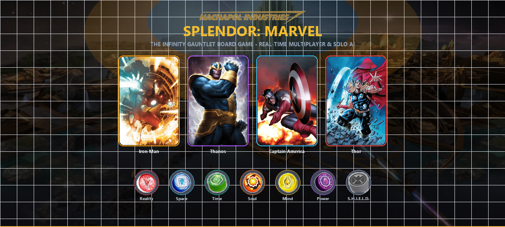
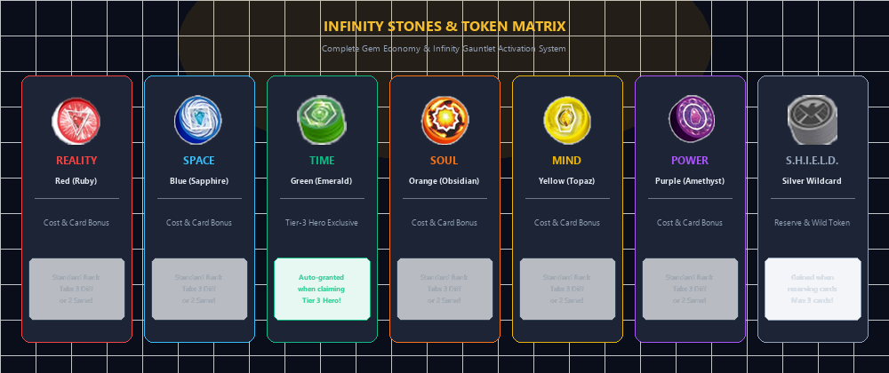
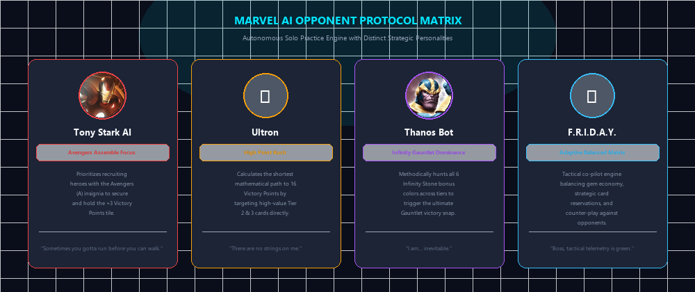
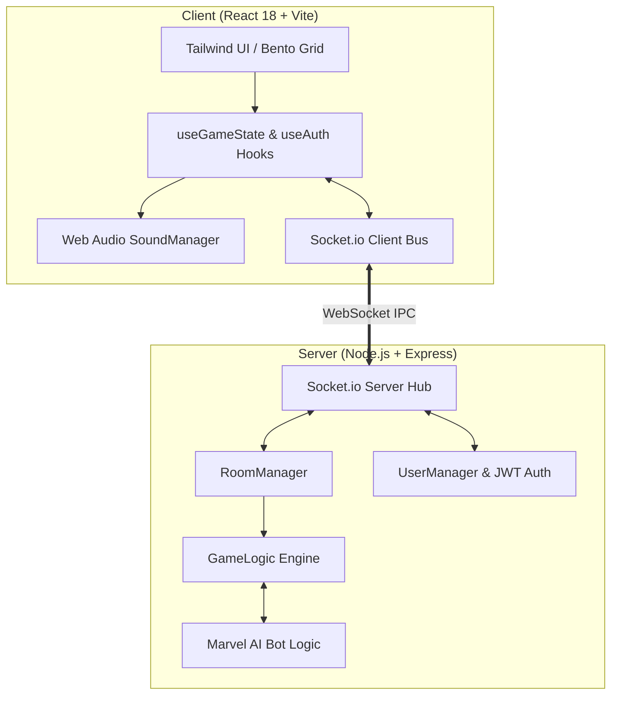

# 🦸‍♂️ Marvel Splendor — Digital Board Game

<p align="center">
  
</p>

<p align="center">
  <strong>เว็บแอปพลิเคชันบอร์ดเกมดิจิทัลแบบเรียลไทม์ ดัดแปลงจากเกมกระดาน Splendor: Marvel</strong><br>
  รองรับการเล่นออนไลน์แบบมัลติเพลเยอร์ (Multiplayer) และโหมดเล่นคนเดียวร่วมกับบอทปัญญาประดิษฐ์ (Solo vs AI)
</p>

<p align="center">
  <a href="https://github.com/sanior09/marvel-splendor/actions/workflows/ci.yml"></a>
  <a href="https://www.typescriptlang.org/"></a>
  <a href="https://react.dev/"></a>
  <a href="https://vitejs.dev/"></a>
  <a href="https://nodejs.org/"></a>
  <a href="https://socket.io/"></a>
  <a href="https://tailwindcss.com/"></a>
  <a href="LICENSE"></a>
  <a href="https://github.com/sanior09/marvel-splendor/pulls"></a>
</p>

<p align="center">
  <a href="#-ภาพรวมและจุดเด่น-features">🌟 ฟีเจอร์หลัก</a> •
  <a href="#-กฎการเล่นและอัญมณี-gameplay">💎 กฎการเล่น</a> •
  <a href="#-เงื่อนไขชัยชนะ-win-conditions">🏆 เงื่อนไขชัยชนะ</a> •
  <a href="#-ระบบบอท-ai-opponents">🤖 บอท AI</a> •
  <a href="#-สถาปัตยกรรมระบบ-architecture">🏗️ สถาปัตยกรรม</a> •
  <a href="#-การติดตั้งและเริ่มเล่น-getting-started">🚀 วิธีติดตั้ง</a> •
  <a href="#-สัญญาอนุญาตและข้อกำหนด-license">📜 สัญญาอนุญาต</a>
</p>

---

## 🌟 ภาพรวมและจุดเด่น (Features)

**Marvel Splendor** เป็นโปรเจกต์ดิจิทัลบอร์ดเกมเชิงกลยุทธ์ ที่จำลองระบบการแข่งขันรวบรวม **Infinity Stones** และเกณฑ์เหล่าฮีโร่และวายร้ายเพื่อประกอบ **Infinity Gauntlet** 

### ✨ ไฮไลต์ของระบบ
* 🌐 **Real-Time Multiplayer:** เล่นออนไลน์ร่วมกับเพื่อน 2–4 คน ผ่าน WebSocket (Socket.io) ซิงค์สถานะเกมและเทิร์นแบบมิลลิวินาที
* 🤖 **Smart AI Opponents:** ระบบบอทปัญญาประดิษฐ์หลากหลายสไตล์ (สายกลยุทธ์, สายป่วน, สายสมดุล, มุ่งแต้มใหญ่) สำหรับฝึกซ้อมในโหมด Solo
* 📱 **Viewport-Locked Responsive UI:** กระดานเกมแสดงผลพอดีหน้าจอ 100% ไม่ต้องเลื่อนจอ (Zero Scrollbar) รองรับทั้งสมาร์ตโฟน แท็บเล็ต และคอมพิวเตอร์
* 🔢 **High-Contrast Numerical Typography:** ปรับจูนฟอนต์และค่า Contrast ของตัวเลขต้นทุนและคะแนนให้อ่านง่าย ชัดเจน ไม่เบลอแม้อยู่บนจอมือถือ
* 🔊 **Procedural Web Audio Engine:** ออกแบบเสียงสังเคราะห์คุณภาพสูงแบบ Zero-latency พร้อม Master Limiter & EQ ป้องกันเสียงแตกพร่า และเสียงคลิกสัมผัสแบบกลไกสมจริง
* 🎨 **Authentic Comic Assets:** รวบรวมการ์ดตัวละคร Marvel ครบทั้ง 90 ใบ (3 ระดับ Tiers) และ 10 การ์ดสถานที่ระดับตำนาน
* 🔐 **Secure Authentication & Guest Mode:** รองรับทั้งการสมัครสมาชิกเข้าสู่ระบบด้วยรหัสผ่านเข้ารหัส (bcrypt + JWT) และโหมดทดลองเล่นด่วน (Guest Mode)

---

## 💎 กฎการเล่นและอัญมณี (Gameplay)

ผู้เล่นผลัดกันเล่นทีละเทิร์น โดยในแต่ละเทิร์นสามารถเลือกทำได้ **1 แอ็กชัน** จาก 3 ตัวเลือก:

<p align="center">
  
</p>

### 1. การหยิบโทเค็นอัญมณี (Take Tokens)
* หยิบอัญมณี **3 สีที่ต่างกัน** สีละ 1 ก้อน (ไม่รวมสีเขียวและสีเทา S.H.I.E.L.D.)
* หรือหยิบอัญมณี **สีเดียวกัน 2 ก้อน** (ทำได้เมื่อกองอัญมณีสีนั้นเหลือกองกลางตั้งแต่ 4 ก้อนขึ้นไป)
* *ข้อจำกัด:* ผู้เล่นถือโทเค็นในมือได้สูงสุดไม่เกิน **10 ก้อน** เมื่อจบรอบ

### 2. การเกณฑ์การ์ดตัวละคร (Recruit Character)
* จ่ายโทเค็นตามต้นทุนที่ระบุบนการ์ด เพื่อนำการ์ดมาวางบนกระดานของตนเอง
* การ์ดที่เกณฑ์แล้วจะมอบ **ส่วนลดสีถาวร (Permanent Discount)** สำหรับใช้ซื้อการ์ดใบถัดไป และอาจให้คะแนนชัยชนะ (Victory Points)

### 3. การจองการ์ด (Reserve Card)
* เลือกจองการ์ดจากแถวกลาง หรือสุ่มจองจากการ์ดใบบนสุดของกอง พร้อมรับโทเค็น **S.H.I.E.L.D. สีเทา (Wildcard)** 1 ชิ้น
* ผู้เล่นสามารถถือการ์ดจองได้สูงสุด **3 ใบ**

| โทเค็น / อัญมณี (Token & Stone) | สี (Color) | สัญลักษณ์ / รหัส | หน้าที่ในเกม |
| :--- | :--- | :--- | :--- |
| 🔴 **Reality Stone** | แดง | `ruby` | จ่ายเกณฑ์การ์ด / มอบส่วนลดสีแดงถาวร |
| 🔵 **Space Stone** | น้ำเงิน | `sapphire` | จ่ายเกณฑ์การ์ด / มอบส่วนลดสีน้ำเงินถาวร |
| 🟢 **Time Stone** | เขียว | `emerald` | **สิทธิพิเศษ:** ได้รับทันที 1 ชิ้นเมื่อเกณฑ์ฮีโร่ Tier 3 สำเร็จ |
| 🟠 **Soul Stone** | ส้ม | `obsidian` | จ่ายเกณฑ์การ์ด / มอบส่วนลดสีส้มถาวร |
| 🟡 **Mind Stone** | เหลือง | `topaz` | จ่ายเกณฑ์การ์ด / มอบส่วนลดสีเหลืองถาวร |
| 🟣 **Power Stone** | ม่วง | `amethyst` | จ่ายเกณฑ์การ์ด / มอบส่วนลดสีม่วงถาวร |
| 🔘 **S.H.I.E.L.D. Token** | เทา (Grey) | `shield` *(wildcard)* | โทเค็นสารพัดประโยชน์ (Wildcard) ใช้แทนอัญมณีสีใดก็ได้ |

---

## 🏆 เงื่อนไขชัยชนะ (Win Conditions)

ผู้เล่นที่จะประกาศชัยชนะและเรียกการเล่นรอบสุดท้าย (Final Round Trigger) ต้องบรรลุเงื่อนไขครบถ้วนทั้ง **3 ประการพร้อมกัน**:

```
┌────────────────────────────────────────────────────────────────────────┐
│               THE INFINITY GAUNTLET VICTORY CRITERIA                   │
├────────────────────────────────────────────────────────────────────────┤
│  [✓] 1. มีคะแนนชัยชนะ (Victory Points) ครบตามเป้าหมาย (ค่าเริ่มต้น 16 แต้ม) │
│  [✓] 2. มีโบนัสอัญมณีครบทั้ง 6 สี (เกณฑ์ฮีโร่ลดต้นทุนครบทั้ง 6 สี)        │
│  [✓] 3. ครอบครองการ์ดฮีโร่ Tier 3 อย่างน้อย 1 ใบ (ถือครอง Time Stone)   │
└────────────────────────────────────────────────────────────────────────┘
```

* **Avengers Assemble (+3 VP):** ผู้เล่นคนแรกที่สะสมสัญลักษณ์ทีมอเวนเจอร์ (`A`) บนการ์ดครบ 3 สัญลักษณ์ จะได้รับแผ่นป้าย Avengers Assemble (+3 แต้ม) แต่หากมีผู้เล่นอื่นสะสมได้มากกว่า แผ่นป้ายจะถูกแย่งไปทันที
* **การตัดสินกรณีเสมอ (Tie-Breaker):** หากมีผู้บรรลุเงื่อนไขมากกว่าหนึ่งคนเมื่อสิ้นสุดรอบ ผู้เล่นที่ใช้จำนวนการ์ดฮีโร่น้อยที่สุดจะเป็นผู้ชนะสูงสุด

---

## 🤖 ระบบบอท (AI Opponents)

ระบบบอทปัญญาประดิษฐ์ถูกพัฒนาด้วย State Machine & Heuristic Decision Tree โดยแยกอัลกอริทึมการคำนวณตามบุคลิกของตัวละคร:

<p align="center">
  
</p>

* **Tony Stark AI (`stark`) — สายกลยุทธ์ทีม:** เน้นการสะสมการ์ดที่มีสัญลักษณ์ `Avengers` เพื่อแย่งชิงและครอบครองแผ่นป้าย Avengers Assemble (+3 VP)
* **Ultron (`ultron`) — สายทำแต้มไว:** มุ่งเป้าการ์ด Tier 2 และ Tier 3 ที่ให้ค่า Victory Points สูงสุดเพื่อปิดเกมอย่างรวดเร็ว
* **Thanos Bot (`thanos`) — สายล่าถุงมือ:** วางแผนสะสมการ์ดโบนัสให้ครบทั้ง 6 สี เพื่อบรรลุเงื่อนไขถุงมืออินฟินิตี้อย่างเป็นระบบ
* **Vision / F.R.I.D.A.Y. (`friday`) — สายสมดุล:** คำนวณความคุ้มค่าแบบ Real-time ปรับสมดุลระหว่างการหยิบโทเค็น การจองการ์ดตัดจังหวะ และการเกณฑ์ตัวละคร

---

## 🏗️ สถาปัตยกรรมระบบ (Architecture)

โครงสร้างระบบถูกออกแบบในรูปแบบ Client-Server แบบ Event-Driven ผ่าน WebSockets:



### รายละเอียดเทคโนโลยี (Tech Stack)
* **Frontend:** React 18, TypeScript, Vite, Tailwind CSS, Lucide Icons, Canvas Viewport Lock
* **Audio Synthesis:** Web Audio API (DynamicsCompressorNode, BiquadFilter, Inharmonic Resonance)
* **Backend:** Node.js, Express, TypeScript, Socket.io
* **Security & Auth:** JSON Web Tokens (JWT), bcrypt.js, LocalStorage persistence

### 🔊 Procedural Web Audio Engine Architecture
ระบบเสียงถูกสังเคราะห์สดแบบเรียลไทม์ (Zero-latency Procedural Synthesis) ผ่าน Web Audio API 100% โดยไม่ต้องโหลดไฟล์เสียงภายนอก (.mp3 / .wav):
* **Inharmonic Crystal Resonance:** จำลองความถี่เรโซแนนซ์ของผลึกวงกลม (1, 2.296, 3.60) เพื่อให้เสียงหยิบ Infinity Stones มีมิติกังวานสมจริง
* **Hardware Tactile Haptics:** เสียงคลิกกลไกความถี่ลดลงอย่างนุ่มนวล (820Hz → 240Hz Exponential Decay) เลียนแบบสวิตช์เครื่องมือพรีเมียม
* **Organic Mechanical Clockwork:** เสียงนับถอยหลังจังหวะเข็มนาฬิกากลไกจริง ตัดเสียงสังเคราะห์แหลมที่รบกวนหูออกทั้งหมด
* **Master Studio Limiter:** ควบคุม Dynamic Range ด้วย `DynamicsCompressorNode` ป้องกันเสียงแตกพร่า (Clipping) และรักษาความคมชัดในทุกลำโพง

---

## 🚀 การติดตั้งและเริ่มเล่น (Getting Started)

### ความต้องการของระบบ (Prerequisites)
* [Node.js](https://nodejs.org/) เวอร์ชั่น 18.0.0 หรือใหม่กว่า
* [Git](https://git-scm.com/)

### 1. โคลนคลังโค้ด (Clone Repository)
```bash
git clone https://github.com/sanior09/marvel-splendor.git
cd marvel-splendor
```

### 2. ติดตั้ง Dependencies
```bash
# ติดตั้งทั้งแพ็กเกจเซิร์ฟเวอร์และไคลเอนต์
npm install
cd client && npm install && cd ..
```

### 3. รันโปรเจกต์ (Development Mode)
```bash
# รันทั้ง Backend Server (:3001) และ Frontend Client (:5173) พร้อมกันในคำสั่งเดียว
npm run dev
```

เปิดเว็บเบราว์เซอร์ไปที่ **`http://localhost:5173`** เพื่อเริ่มเล่นเกมได้ทันที!

---

## 📁 โครงสร้างโปรเจกต์ (Project Structure)

```text
marvel-splendor/
├── client/                     # Frontend Application (React + Vite)
│   ├── src/
│   │   ├── components/         # UI Components (Board, Lobby, Login, Modals)
│   │   ├── data/               # Marvel Cards (Tier 1-3), Locations, Maps
│   │   ├── hooks/              # Custom Hooks (useGameState, useAuth)
│   │   ├── utils/              # SoundManager, Avatar Resolver
│   │   └── App.tsx             # Root Router & Maintenance Guard
│   ├── index.html              # Main HTML entry point
│   └── vite.config.ts          # Vite configuration
├── src/                        # Backend Server (Node.js + Express)
│   ├── server/
│   │   ├── GameLogic.ts        # Turn execution, token bank, validation
│   │   ├── RoomManager.ts      # Multiplayer lobby and room coordination
│   │   ├── BotLogic.ts         # Marvel AI heuristics and strategy
│   │   └── index.ts            # Server entry point & WebSocket handlers
├── shared/                     # Shared TypeScript types between Client & Server
├── docs/                       # Documentation and infographic image assets
└── package.json                # Project scripts and dependencies
```

---

## 🤝 การมีส่วนร่วม (Contributing)

ยินดีต้อนรับการมีส่วนร่วมจากนักพัฒนาทุกคน! หากท่านพบข้อผิดพลาดหรือต้องการเสนอแนะฟีเจอร์ใหม่:
1. Fork คลังโปรเจกต์นี้
2. สร้าง Feature Branch (`git checkout -b feature/AmazingFeature`)
3. Commit การเปลี่ยนแปลง (`git commit -m 'feat: Add some AmazingFeature'`)
4. Push ไปยัง Branch (`git push origin feature/AmazingFeature`)
5. เปิด Pull Request เพื่อตรวจสอบร่วมกัน

---

## 📜 สัญญาอนุญาตและข้อกำหนด (License & Disclaimer)

* **Source Code License:** โค้ดของโปรเจกต์นี้เผยแพร่ภายใต้สัญญาอนุญาต **[MIT License](LICENSE)**
* **Marvel Intellectual Property Disclaimer:** ชื่อตัวละคร, การ์ตูน, สถานที่, สัญลักษณ์ และทรัพย์สินทางปัญญาที่เกี่ยวข้อง เป็นเครื่องหมายการค้าและลิขสิทธิ์ของ **MARVEL Entertainment / Marvel Characters, Inc.** และ Space Cowboys / Asmodee โปรเจกต์นี้สร้างขึ้นเพื่อการศึกษาและการวิจัยเทคโนโลยีเว็บแอปพลิเคชัน (Non-commercial fan-made project strictly for educational and personal research purposes)

<p align="center">
  Developed with ❤️ by <a href="https://github.com/sanior09">sanior09</a>
</p>
