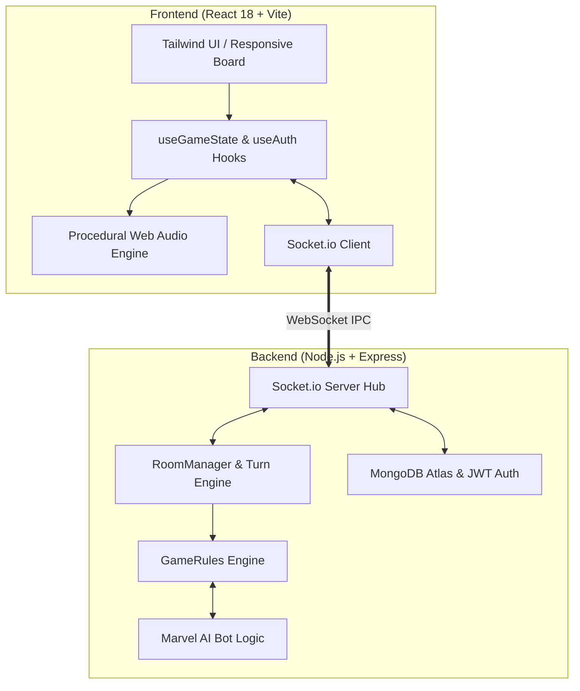

# 🦸‍♂️ Marvel Splendor — Digital Board Game

<p align="center">
  
</p>

<p align="center">
  <strong>เว็บแอปพลิเคชันดิจิทัลบอร์ดเกม Splendor: Marvel แบบเรียลไทม์</strong><br>
  รองรับทั้งการเล่นออนไลน์หลายคน (Multiplayer) และดวลเดี่ยวกับ AI Bot
</p>

<p align="center">
  <a href="https://github.com/sanior09/marvel-splendor/actions/workflows/ci.yml"></a>
  <a href="https://www.typescriptlang.org/"></a>
  <a href="https://react.dev/"></a>
  <a href="https://vitejs.dev/"></a>
  <a href="https://nodejs.org/"></a>
  <a href="https://socket.io/"></a>
  <a href="https://tailwindcss.com/"></a>
  <a href="LICENSE"></a>
</p>

<p align="center">
  <a href="#-จุดเด่นของเกม">🌟 จุดเด่น</a> •
  <a href="#-กฎการเล่น">💎 กฎการเล่น</a> •
  <a href="#-เงื่อนไขชัยชนะ">🏆 เงื่อนไขชนะ</a> •
  <a href="#-ระบบบอท-ai">🤖 บอท AI</a> •
  <a href="#-สถาปัตยกรรมระบบ">🏗️ เทคโนโลยี</a> •
  <a href="#-วิธีติดตั้งและเริ่มเล่น">🚀 วิธีเริ่มเล่น</a>
</p>

---

## 🌟 จุดเด่นของเกม

* 🌐 **Real-Time Multiplayer:** เล่นออนไลน์ 2–4 คน ซิงค์สถานะเกมและเทิร์นแบบเรียลไทม์ผ่าน WebSocket (Socket.io)
* 🤖 **AI Opponents:** บอทฝึกซ้อม 4 สไตล์ (สายทีม, สายสปีดแต้ม, สายถุงมือ, สายสมดุล) สำหรับโหมด Solo
* 📱 **Responsive Viewport:** กระดานเกมล็อกพอดีหน้าจอ (Zero Scrollbar) เล่นได้ลื่นไหลทั้งมือถือ แท็บเล็ต และคอมพิวเตอร์
* 🎨 **Complete Marvel Deck:** การ์ดฮีโร่และวายร้ายครบ 90 ใบ (3 Tiers) + 10 การ์ดสถานที่
* 🔊 **Procedural Web Audio:** เสียงสังเคราะห์เรียลไทม์ผ่าน Web Audio API 100% ไม่ต้องโหลดไฟล์เสียงภายนอก
* 🔐 **Auth & Guest Mode:** เข้าเล่นได้ทันทีทั้งแบบแขก (Guest) หรือสมัครสมาชิกบันทึกสถิติ (JWT + bcrypt)

---

## 💎 กฎการเล่น

ผู้เล่นผลัดกันเล่นคนละ 1 เทิร์น โดยเลือกทำได้ **1 แอ็กชัน** จาก 3 ตัวเลือก:

<p align="center">
  
</p>

1. **หยิบโทเค็น (Take Tokens):**
   * หยิบ 3 สีต่างกัน สีละ 1 ก้อน (ไม่รวมสีเขียวและสีเทา) หรือ
   * หยิบสีเดียวกัน 2 ก้อน (ต้องมีในกองกลางเหลือ ≥ 4 ก้อน)
   * *จำกัดถือโทเค็นสูงสุด 10 ก้อน*
2. **เกณฑ์การ์ด (Recruit Character):**
   * จ่ายโทเค็นตามต้นทุนบนการ์ด เพื่อรับส่วนลดสีถาวร และคะแนนชัยชนะ (VP)
3. **จองการ์ด (Reserve Card):**
   * จองการ์ด 1 ใบจากกระดานหรือกองจั่ว พร้อมรับโทเค็น S.H.I.E.L.D. (Wildcard) 1 ชิ้น *(ถือการ์ดจองได้สูงสุด 3 ใบ)*

### รายการโทเค็น / อัญมณี
| อัญมณี | สี | โค้ด | บทบาทในเกม |
| :--- | :---: | :---: | :--- |
| 🔴 **Reality** | แดง | `ruby` | เกณฑ์การ์ด / มอบส่วนลดสีแดงถาวร |
| 🔵 **Space** | น้ำเงิน | `sapphire` | เกณฑ์การ์ด / มอบส่วนลดสีน้ำเงินถาวร |
| 🟢 **Time** | เขียว | `emerald` | **สิทธิพิเศษ:** ได้รับ 1 ชิ้นทันทีเมื่อเกณฑ์การ์ด Tier 3 |
| 🟠 **Soul** | ส้ม | `obsidian` | เกณฑ์การ์ด / มอบส่วนลดสีส้มถาวร |
| 🟡 **Mind** | เหลือง | `topaz` | เกณฑ์การ์ด / มอบส่วนลดสีเหลืองถาวร |
| 🟣 **Power** | ม่วง | `amethyst` | เกณฑ์การ์ด / มอบส่วนลดสีม่วงถาวร |
| 🔘 **S.H.I.E.L.D.** | เทา | `shield` | Wildcard ใช้แทนสีใดก็ได้ (ได้จากการจองการ์ด) |

---

## 🏆 เงื่อนไขชัยชนะ

เกมจะเข้าสู่รอบสุดท้าย (Final Round) เมื่อมีผู้เล่นบรรลุครบ **ทั้ง 3 เงื่อนไขพร้อมกัน**:

> [!IMPORTANT]
> 1. **คะแนนครบเป้าหมาย:** มีคะแนนชัยชนะ (VP) ≥ 16 แต้ม (ค่าเริ่มต้น)
> 2. **โบนัสครบ 5 สี:** เกณฑ์การ์ดมีโบนัสส่วนลดครบทั้ง 5 สี (แดง, น้ำเงิน, ส้ม, เหลือง, ม่วง)
> 3. **ครอง Time Stone:** ถือครองโทเค็น Time Stone สีเขียวอย่างน้อย 1 ชิ้น (ได้จากการเกณฑ์การ์ด Tier 3)

* **Avengers Assemble (+3 VP):** ผู้เล่นคนแรกที่มีสัญลักษณ์ `A` บนการ์ดครบ 3 ใบ จะได้แผ่นป้าย +3 แต้ม (สามารถถูกผู้เล่นอื่นที่มีสัญลักษณ์มากกว่าแย่งไปได้)
* **การตัดสินเมื่อเสมอ:** ตัดสินจากจำนวนการ์ด Tier 3 มากกว่า หากเท่ากันตัดสินด้วยจำนวนการ์ดรวมที่น้อยกว่า

---

## 🤖 ระบบบอท AI

<p align="center">
  
</p>

* **Tony Stark (`stark`):** เน้นสะสมการ์ดสัญลักษณ์ `Avengers` เพื่อแย่งแผ่นป้าย +3 VP
* **Ultron (`ultron`):** มุ่งเป้าการ์ดแต้มสูง Tier 2–3 เพื่อเร่งจบเกมเร็ว
* **Thanos (`thanos`):** วางแผนสะสมการ์ดโบนัสครบสี เพื่อบรรลุเงื่อนไข Infinity Gauntlet
* **F.R.I.D.A.Y. (`friday`):** คำนวณความคุ้มค่าแบบ Real-time ปรับตัวตามสถานการณ์บนกระดาน

---

## 🏗️ สถาปัตยกรรมระบบ



### รายละเอียดเทคโนโลยี (Tech Stack)
* **Frontend:** React 18, TypeScript, Vite, TailwindCSS, Framer Motion
* **Backend:** Node.js, Express, TypeScript, Socket.io
* **Database & Auth:** MongoDB Atlas (Mongoose), JWT, bcryptjs
* **Audio Engine:** Web Audio API (Synthesized Real-time SFX — Zero external audio files)

---

## 🚀 วิธีติดตั้งและเริ่มเล่น

### สิ่งที่ต้องมี
* [Node.js](https://nodejs.org/) (v18+) และ [Git](https://git-scm.com/)

```bash
# 1. โคลนคลังโค้ด
git clone https://github.com/sanior09/marvel-splendor.git
cd marvel-splendor

# 2. ติดตั้ง Dependencies
npm install
cd client && npm install && cd ..

# 3. รันทั้ง Backend (:3001) และ Frontend (:5173) พร้อมกัน
npm run dev
```

เปิดเว็บเบราว์เซอร์ไปที่ **`http://localhost:5173`** เพื่อเริ่มเล่นทันที

---

## 📁 โครงสร้างโปรเจกต์

```text
marvel-splendor/
├── client/                     # Frontend (React 18 + Vite + TailwindCSS)
│   ├── src/components/         # UI กระดาน ล็อบบี้ ล็อกอิน การ์ด
│   ├── src/hooks/              # Custom Hooks (useGameState, useAuth)
│   └── src/utils/              # Web Audio Engine, Avatar Resolver
├── src/                        # Backend Server & Game Engine
│   ├── engine/                 # กฎเกม (GameLogic), บอท (BotLogic), ข้อมูลการ์ด
│   ├── server/                 # Socket.io Hub, RoomManager, Auth (JWT)
│   └── types/                  # Shared TypeScript Types
└── docs/                       # รูปภาพและเอกสารประกอบ
```

---

## 📜 สัญญาอนุญาตและข้อกำหนด

* **Source Code License:** เผยแพร่ภายใต้สัญญาอนุญาต [MIT License](LICENSE)
* **Marvel Disclaimer:** ชื่อตัวละคร, เครื่องหมายการค้า และลิขสิทธิ์เป็นของ **MARVEL Entertainment** และ Space Cowboys / Asmodee โปรเจกต์นี้สร้างขึ้นเพื่อการศึกษาและการวิจัยเทคโนโลยีเท่านั้น (Non-commercial fan-made project)

<p align="center">
  Developed with ❤️ by <a href="https://github.com/sanior09">sanior09</a>
</p>
